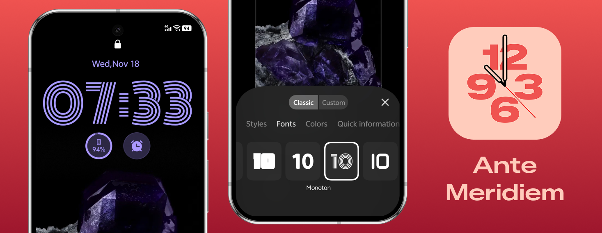

# Ante Meridiem

An LSPosed module for OriginOS 6 that brings custom lock screen clock fonts, an optional analog dial mode, digital/analog clock size scaling with automatic widget adaptation, and date customization (hide or match clock font).

## Build

Requires **JDK 17** and **Android SDK 35** (`ANDROID_HOME` set or `sdk.dir=...` in `local.properties`).

```bash
# Using Make (creates dist/*.apk)
make

# Or using Gradle directly
./gradlew :app:assembleDebug
```

The built APK is located at `app/build/outputs/apk/debug/app-debug.apk`.
